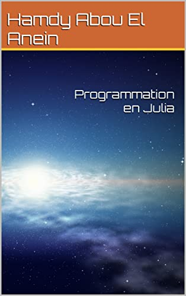

# Programmes du livre : [Programmation en Julia](https://www.amazon.fr/Programmation-Julia-Hamdy-Abou-Anein/dp/B0BM3MFLNG/ref=tmm_pap_swatch_0?_encoding=UTF8&qid=1668504743&sr=8-1)

Auteur : [Hamdy Abou El Anein](https://www.amazon.fr/Hamdy-Abou-El-Anein/e/B0BM89T88X/ref=dp_byline_cont_pop_book_1)

## Maintenance des exemples

Mainteneur : Hamdy Abou El Anein — hamdy.aea@protonmail.com

`julia runtests.jl` lance 7 assertions hors ligne avec la bibliothèque standard. Le jeu traite les saisies invalides et la fin du flux sans récursion. Les exemples de journalisation ferment leur fichier sans laisser un logger global pointant vers un flux fermé, et ajoutent les messages sans effacer le journal existant.

Les exemples Compose, PyCall et HTTP/JSON3 restent optionnels : leurs dépendances et les services externes ne sont pas couverts par ces tests.
